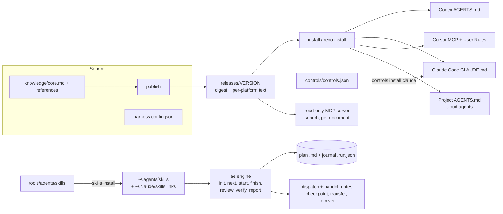

# Agentic Harness

One rulebook, a set of skills, and a small execution engine for AI coding agents. You edit one policy, publish it as an immutable release, and install it into Codex, Claude Code, Cursor, and other agents.

Interactive explainer: [the whole project in figures](https://yeruvamaheswar.github.io/Agent-Harness-by-Uma/project-explainer.html). Its source is `docs/project-explainer.html`.

## What it is

**What it does.** The harness turns your engineering rules into files that each agent loads at the start of a session. It also ships a set of skills (planning, verification, budgeting, resuming work), an engine called `ae` that records state and evidence for a multi-agent plan, and a set of enforced controls for Claude Code.

**Problems it solves.**
- Each agent reads a different instruction file, so rules drift. One source and one `install` command per agent keep them equal.
- Edited rules lose history. A release is frozen with a SHA-256 digest, and the CLI refuses a release whose files changed.
- "Done" is often a claim, not a result. The `ae` engine marks a slice `VERIFIED` only when it saw the Verify command exit 0.
- Work stops when a session or a usage limit ends. Plans, a journal, handoff notes, and `continue-work` let a fresh session continue from the real repo state.

**Who should use it.** One developer who works with several coding agents and wants the same rules, reviews, and evidence in all of them. It is a personal and small-team tool. It is not a hosted service.

**Design philosophy.**
- Prove one small end-to-end slice, then expand (tracer bullets).
- Prefer evidence over claims. Status output separates `configurationVerified` (the files match) from `behaviorVerified` (a fresh session followed them). The second one stays `false` until someone checks.
- Back up before every change, record a receipt, and never delete outside Git.
- Keep context small. Most skills load only when you call them by name.

**How it differs from a folder of prompts.**

| A folder of prompts | This harness |
| --- | --- |
| Copied by hand into each tool | `install` writes it, with a backup and a receipt |
| No version | Immutable releases with a digest; `rollback` and `verify` |
| No check that a copy is current | `status`, `verify`, and `skills status` report drift |
| Agent says "done" | The engine records command, exit code, and Git head as evidence |
| Rules only advise | `controls install claude` adds deny and ask rules that Claude Code enforces |

## Architecture



How the parts work together:

1. **Policy.** `knowledge/core.md` plus `knowledge/references/` is the source. `publish` freezes it into `releases/<version>/`. `install` renders it for each agent. `repo install PATH` puts the same block into a project's `AGENTS.md`.
2. **Skills.** Each skill is a folder in `tools/agents/skills/` with a `SKILL.md`. `skills install NAME` copies it to `~/.agents/skills/NAME` (Codex reads it) and links `~/.claude/skills/NAME` (Claude Code reads it). Lifecycle: `skills status` shows `absent`, `current`, `stale`, `modified`, `unmanaged`, or `foreign`; `install`, `verify`, and `uninstall` change or check it, with backups under `.state/backups/skills/`. Some skills load by description; the rest load only when you call them by name. The table in the Skills section shows which. See [docs/platforms.md](docs/platforms.md#shared-skills-and-visibility).
3. **Planning and agent choice.** `multi-agent-planning` writes a plan in `plans/<slug>.md`, split into slices. Each slice names a builder, a reviewer, and a fallback, with a model and effort. Claude plans, reviews, and decides. Codex and Cursor build with `auto`. Grok only reviews. `subagent-budget` decides how many children to start. There is no fixed cap. See [docs/multi-agent-planning.md](docs/multi-agent-planning.md) and [docs/subagent-budget.md](docs/subagent-budget.md).
4. **Coordination and evidence.** The `ae` engine reads the plan, keeps a journal next to it, and moves each slice through `PLANNED`, `READY`, `IN_PROGRESS`, `AGENT_FINISHED`, `REVIEWED`, `VERIFIED`, and `INTEGRATED`. A command guard (`ae check`) allows, asks about, or denies each command. `ae dispatch` and `ae handoff` produce the routing and the note a worker receives.
5. **Memory, context, and handoffs.** There is no hidden memory. State lives in files: the plan, the journal, the handoff note, and the checkpoint. `ae recover PLAN` reports drift, stale evidence, and the next step after a crash. `continue-work` resumes a task in a fresh session from that trail. `ae usage`, `checkpoint`, `prepare`, and `transfer` move a slice to another agent when a limit is near; `usage` reads a snapshot file you write, because there is no live usage source.
6. **Retrieval.** A read-only MCP server (`src/mcp.ts`) lets agents search the released reference documents. Search is local keyword search.

**Design OS and pstack.** The repo shows only these points of contact:
- Design OS is a separate project (`designOS-by-Uma`). `repo install` keeps a Design OS block in `AGENTS.md` intact (covered by `tests/repo.test.ts`; one test runs the real Design OS installer only when that project is checked out next to this one). The explainer design spec records a Design OS consultation: [docs/design/explainer-design-spec.md](docs/design/explainer-design-spec.md).
- pstack appears as one routing exception, written in two skills (`subagent-budget` and `multi-agent-planning`): pstack panels in Cursor use named models instead of `auto`. The harness does not install or configure pstack.

## Install

**Prerequisites.** Node.js 24 or later, npm, and Git. Notion, Supabase, and embedding credentials are optional.

**Supported platforms.** The installer writes global rules for Codex, Claude Code, Cursor, and a generic package. `repo install` writes project rules for cloud agents. Grok Bot needs manual steps. See [docs/platforms.md](docs/platforms.md).

1. Clone the repository. This command needs the network, so it is shown here but not part of the validated blocks.

   ```text
   git clone https://github.com/yeruvamaheswar/Agent-Harness-by-Uma.git
   cd Agent-Harness-by-Uma
   ```

2. From the clone root, install the dependencies and run the checks. `npm test` takes about two minutes.

   ```bash
   npm ci
   npm run typecheck
   npm test
   ```

3. Choose a release. The newest folder in `releases/` is the active policy release; at the time of writing it is `1.5.5`. `activate` selects it. Expect `"active": "1.5.5"`.

   ```bash
   ls releases
   npm run harness -- activate 1.5.5
   ```

   To publish your own rules instead, edit `knowledge/core.md` and `knowledge/references/`, run `preview` to get a digest, and approve that exact digest. The version must not exist in `releases/`. `--bootstrap` is required when the release does not come from a Notion import. The digest below is a placeholder, so this block is not run as shown.

   ```text
   npm run harness -- preview
   npm run harness -- publish 2.0.0 --approve-sha DIGEST --bootstrap
   ```

4. Optional: connect Notion. `harness.config.json` holds the repo owner's Notion page IDs. Replace them with your own, or ignore them and author in local files. See [docs/notion.md](docs/notion.md).

5. Install the policy into each agent you use. Each command backs up the old file and writes a receipt in `.state/`.

   ```bash
   npm run harness -- install codex
   npm run harness -- install claude
   npm run harness -- install cursor-files
   npm run harness -- install generic
   ```

   Cursor needs one manual step: paste `releases/<version>/cursor/user-rules.md` into Cursor User Rules, then run `confirm cursor-user-rules`. See [docs/platforms.md](docs/platforms.md#cursor).

6. Optional integrations: enforced Claude Code controls, and shared skills.

   ```bash
   npm run harness -- controls install claude
   npm run harness -- skills install subagent-budget multi-agent-planning
   ```

7. Verify.

   ```bash
   npm run harness -- status
   npm run harness -- verify claude
   npm run harness -- verify codex
   npm run harness -- controls verify claude
   npm run harness -- skills verify subagent-budget multi-agent-planning
   ```

   A good result shows `configurationVerified: true`. It always shows `behaviorVerified: false`. Start a fresh session in each agent and run the checks in [tests/README.md](tests/README.md) to see whether the agent follows the policy.

**Upgrade.** Pull new changes, activate the newer release, and install again. The pull needs a remote, so it is not part of the validated blocks.

```text
git pull
npm ci
npm run harness -- activate NEW_VERSION
npm run harness -- install claude
npm run harness -- skills install NAME --replace
```

**Removal.** Each command restores the earlier file or moves files into `.state/backups/`. It refuses when you edited the file after installation.

```bash
npm run harness -- uninstall claude
npm run harness -- uninstall codex
npm run harness -- uninstall cursor-files
npm run harness -- uninstall generic
npm run harness -- controls uninstall claude
npm run harness -- skills uninstall subagent-budget multi-agent-planning
```

## Quick start

Goal: in about five minutes, put the policy into a scratch project, check it, and remove it. This touches no global agent file. Run it from the clone root after `npm ci`.

```bash
npm run harness -- activate 1.5.5
DEMO=$(mktemp -d)
npm run harness -- repo install "$DEMO"
npm run harness -- repo verify "$DEMO"
head -n 8 "$DEMO/AGENTS.md"
npm run harness -- search 'tracer bullet'
npm run harness -- repo uninstall "$DEMO"
```

What you should see: `repo install` writes `AGENTS.md` and `CLAUDE.md` in the scratch folder, `repo verify` prints `"configurationVerified": true`, `search` returns the "Tracer bullets" section with a citation, and `repo uninstall` removes only the harness block. For the engine, run the throwaway plan in [workflow 6a of docs/workflows.md, the engine demo](docs/workflows.md#6-run-a-validated-overnight-autonomous-workflow).

## Skills

These skills live in `tools/agents/skills/`. Install one with `npm run harness -- skills install NAME`. Details for each are in [docs/skills.md](docs/skills.md).

<!-- BEGIN GENERATED: skills -->
| Skill | Status | What it does | How to use |
| --- | --- | --- | --- |
| autonomous-engineering | beta | Execute, review, and recover a multi-agent-planning plan to VERIFIED slices, with an engine that records state and evidence and refuses unsafe commands. | /autonomous-engineering; Codex $autonomous-engineering. Also loads by description. |
| continue-work | beta | Resume a task in a new session from the prior trail and the real repo state, then stop at the resume point. | /continue-work; Codex $continue-work. Load only by name. |
| grill-me | stable | Interview the user relentlessly before building until goals, constraints, and decisions are settled. | /grill-me; Codex $grill-me. Also loads by description. |
| html-explainer | stable | Write plans, audits, reviews, reports, and comparisons as a plan-page Markdown file and build its HTML page with md-view.sh. | /html-explainer; Codex $html-explainer. Also loads by description. |
| make-it-verifiable | beta | Plan how to prove a change works before any code, then run those checks with evidence. | /make-it-verifiable; Codex $make-it-verifiable. Load only by name. |
| multi-agent-planning | stable | Plan software work as verified slices and route each slice to an agent, model, and effort. | /multi-agent-planning; Codex $multi-agent-planning. Also loads by description. |
| render-rules | stable | Platform rules and a render.yaml Blueprint checklist for deploying to Render. | /render-rules; Codex $render-rules. Also loads by description. |
| subagent-budget | stable | Decide how many subagents to start, which provider and model each gets, and at what effort, so usage is spent where it pays and no provider sits idle. | /subagent-budget; Codex $subagent-budget. Also loads by description. |
| thread-continuity | experimental | Hand a T3 Code task to one fresh thread with the same project, checkout, mode, and the user's original approval, so the successor continues without asking again and never writes beside its predecessor. | /thread-continuity; Codex $thread-continuity. Load only by name. |
| verify | beta | Check a built product against its contract in a fresh session and report what passes, fails, or is unknown. | /verify; Codex $verify. Load only by name. |
<!-- END GENERATED: skills -->

## Workflows

[docs/workflows.md](docs/workflows.md) walks through seven workflows. Each one is labeled `runnable` (its commands ran in a clean clone with a temporary home, and exited 0) or `concept` (it needs a live agent session or a provider that could not be run in validation).

| # | Workflow | Label |
| --- | --- | --- |
| 1 | Set up a new project | runnable |
| 2 | Use several coding agents | concept (needs live agent sessions) |
| 3 | Choose a model by task complexity | runnable |
| 4 | Recover from a usage limit | runnable (invented usage snapshot) |
| 5 | Continue in a fresh session | runnable for `ae recover`; concept for the `continue-work` skill |
| 6a | The engine on a throwaway plan | runnable |
| 6b | The unattended overnight run | concept (none was observed) |
| 7 | Apply Design OS to a frontend project | concept |

## Operations

**Configuration reference.**

| File or flag | What it controls |
| --- | --- |
| `harness.config.json` | The core policy path, the reference documents, and the optional Notion page IDs |
| `knowledge/core.md`, `knowledge/references/` | The policy source |
| `releases/<version>/` | Immutable releases. Never edit by hand |
| `controls/controls.json` | The enforced Claude Code deny and ask rules: `no-force-push`, `ask-push-main`, `ask-force-with-lease`, `no-secret-reads`, `ask-deploys`, `no-self-edit` |
| `.state/` | Private backups, receipts, and manual-step records. Ignored by Git |
| `--root DIR` or `HARNESS_ROOT` | Keeps harness content in a different folder from the code. `--root` wins |
| `evals/cases.jsonl`, `evals/results/` | Behavior cases and logged run rows |

The full command list is in [docs/README.md](docs/README.md). `npm run harness -- help` prints it too.

**Environment variables.** The harness reads these names. Put values only in your shell or in the ignored env files. Never commit them or paste them into chat.

| Name | Used for |
| --- | --- |
| `HARNESS_ROOT` | Harness content folder (same as `--root`) |
| `CODEX_HOME` | Codex configuration folder, when it is not `~/.codex` |
| `CLAUDE_CONFIG_DIR` | Claude Code configuration folder, when it is not `~/.claude` |
| `NOTION_TOKEN` | Notion import. Optional. Set it in the ignored env file |
| `SUPABASE_URL` | Optional Supabase indexing and search. Parked feature |

`.env.local` holds publishing credentials. `.env.runtime` holds read-only retrieval credentials. Both are ignored by Git.

**Security and permission boundaries.**
- Every install backs up the old file, writes a receipt, and refuses to overwrite a file you edited later. Uninstall moves files; it does not delete them outside Git.
- `controls install claude` adds rules that Claude Code enforces. Bash rules match command prefixes. They stop plain commands, not a determined bypass.
- The `ae` command guard checks every Verify command and the engine refuses anything that is not `allow`. Free-text flags are redacted before they reach the journal.
- Authority comes only from the user. The engine has no commit grant: a typed `git commit`, push, merge, or PR command stays user-approved.
- The harness never commits or pushes for you. `SECURITY.md` explains how to report a vulnerability.
- Instructions guide models. They cannot force behavior, and `status` never claims it.

**Testing and evals.**

```bash
npm run typecheck
npm run harness -- catalog build
npm run harness -- skills catalog --check
npm run harness -- eval list
npm run harness -- context audit
```

`npm test` runs every automated test in temporary homes. It reports its own test count; read it from the output instead of from this page. Automated tests do not call live services or touch your real settings. Behavior cases (`eval run`) start a real headless agent session and spend tokens, so run them on purpose. CI runs typecheck, tests, the pack catalog freshness check, the skills catalog check, and a secret scan (`.github/workflows/checks.yml`). Fresh-session acceptance steps are in [tests/README.md](tests/README.md).

## Troubleshooting

| Symptom | Cause and fix |
| --- | --- |
| `Cannot find package 'zod'` | Dependencies are missing. Run `npm ci` in the clone root |
| `No active release` in `status` | A fresh clone has no selection yet. Run `npm run harness -- activate VERSION` for a folder in `releases/` |
| `unknown command` | Run `npm run harness -- help` and compare. Node 24 or later is required |
| `skills catalog --check` fails | A skill folder, `docs/skills.md`, or a generated block changed. Update `docs/skills.md`, then run `skills catalog --write` and review the diff |
| `uninstall` refuses | You edited the installed file after installation. Compare with the backup in `.state/backups/` and reconcile by hand |
| `verify` shows a mismatch | Reinstall the platform, or restore the release folder from Git. The CLI rejects a release whose digest changed |
| A skill shows `stale` or `modified` in `skills status` | Source changed, or the installed copy was edited. `skills install NAME --replace` updates it after a backup |
| `status` lists the `cursor-user-rules` step as needed | Paste the user rules file into Cursor, then run `confirm cursor-user-rules` |
| `ae check` exits 2 | The guard answered `ask` or `deny`. The JSON names the rule. This is the guard working, not an error |

## Contributing

Run `npm ci`, `npm run typecheck`, and `npm test` before a pull request. Read [CONTRIBUTING.md](CONTRIBUTING.md) for rule packs, skills, the generated blocks, and how README commands are validated. Do not commit or push credentials, private paths, or private plans.

## Known limitations

The full audit is [docs/audits/production-readiness-audit.md](docs/audits/production-readiness-audit.md). It is a draft and lists what is checked and what is not. In short:

- Installed files are not proven behavior. Every `verify` command prints `behaviorVerified: false` until a fresh session is checked. Fresh-session checks of the active release in Codex and Cursor are not done.
- Cursor User Rules, Claude web and desktop memory, and Grok Bot profiles are manual steps. No tool can read them.
- `repo install` and `skills install --repo` have unit tests and the throwaway run in the workflows. They were not run against a real second project.
- `ae usage` needs a snapshot file that you write. There is no live usage source.
- This repository documents no observed unattended overnight run. The engine pieces (`charter`, `report`, the guard) run and have tests.
- `thread-continuity` is experimental and only for T3 Code. Its later slices are not released.
- Supabase semantic search, add-on packs, and the Grok export are parked. Code and docs remain, but they are not part of the supported workflow.
- There is no lint step. Typecheck is the only static gate.
- Skills have a maturity label in the table above (stable, beta, experimental). A label is not proof that a skill works in every session.

## Releases and versions

The active policy release is the newest folder in `releases/`: `1.5.5` at the time of writing. [releases/README.md](releases/README.md) lists every release with its date and digest. Each release is immutable and has its own README. A new policy needs a new version: `preview`, then `publish VERSION --approve-sha DIGEST --bootstrap`, then `install` for each agent. `status` prints the active release and what is installed. `rollback VERSION` selects an earlier release; reinstall each platform afterwards. The `package.json` version is not the policy release.

## Docs map

| Guide | What it covers |
| --- | --- |
| [docs/README.md](docs/README.md) | Every command, backups, recovery, eval platforms |
| [docs/skills.md](docs/skills.md) | One reference entry per skill |
| [docs/workflows.md](docs/workflows.md) | Seven workflows, each labeled runnable or concept |
| [docs/platforms.md](docs/platforms.md) | Codex, Claude Code, Cursor, Grok Bot, repo scope, skill visibility |
| [docs/multi-agent-planning.md](docs/multi-agent-planning.md) | The slice planner: invocation, routing, states, install |
| [docs/subagent-budget.md](docs/subagent-budget.md) | How many children to start, which model and effort |
| [docs/project-explainer.html](docs/project-explainer.html) | The interactive explainer |
| [docs/audits/production-readiness-audit.md](docs/audits/production-readiness-audit.md) | What is verified and what is not |
| [docs/design/explainer-design-spec.md](docs/design/explainer-design-spec.md) | Design spec for the explainer |
| [docs/notion.md](docs/notion.md), [docs/retrieval.md](docs/retrieval.md), [docs/packs.md](docs/packs.md) | Optional: Notion, retrieval, add-on packs (parked) |
| [CONTRIBUTING.md](CONTRIBUTING.md), [SECURITY.md](SECURITY.md) | How to contribute and report a vulnerability |
| [src/README.md](src/README.md), [tests/README.md](tests/README.md), [knowledge/README.md](knowledge/README.md), [supabase/README.md](supabase/README.md), [.github/README.md](.github/README.md) | Code, tests, policy source, database, CI |

## License

MIT. See [LICENSE](LICENSE).
