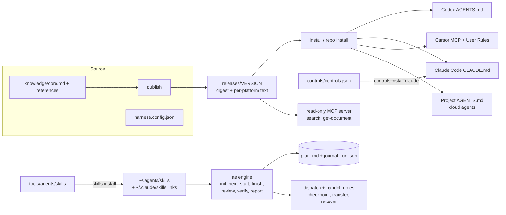
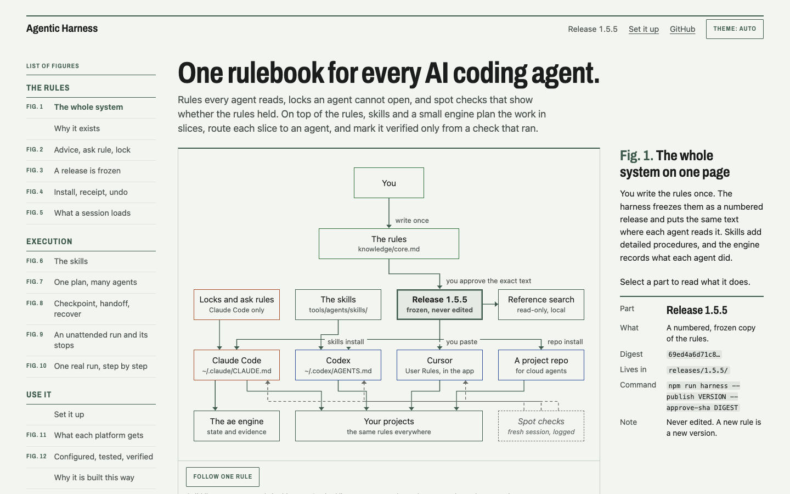
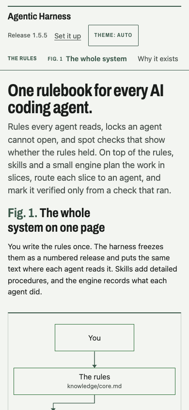
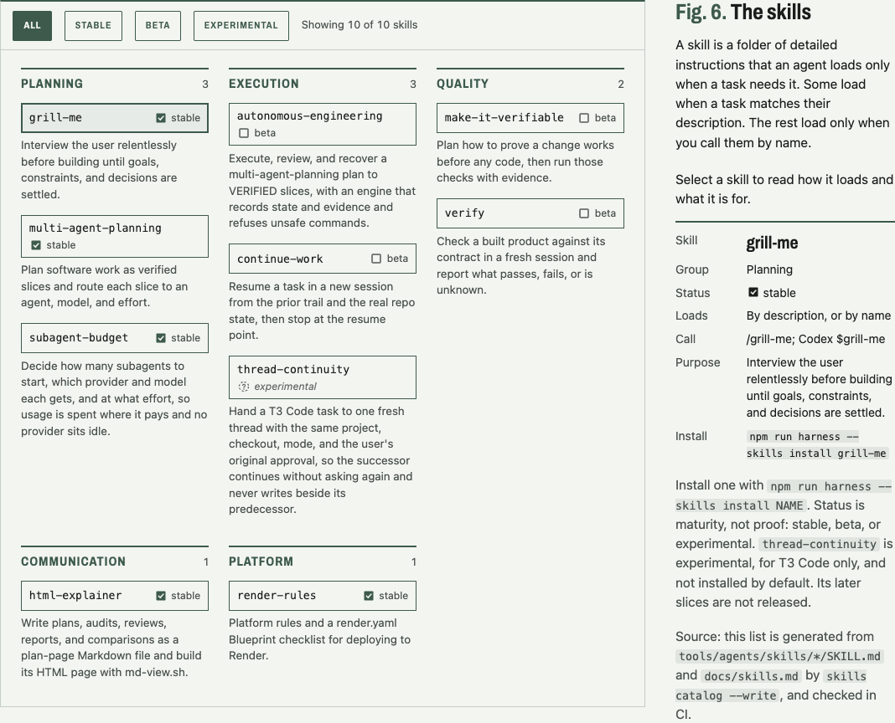
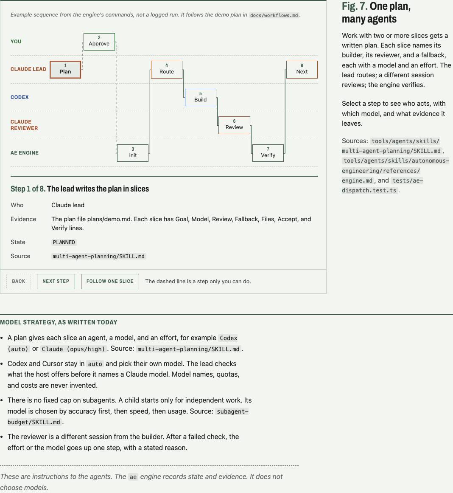

# Agentic Harness

One rulebook, a set of skills, and a small execution engine for AI coding agents. You edit one policy, publish it as an immutable release, and install it into Codex, Claude Code, Cursor, and other agents. It is for one developer, or a small team, who works with several coding agents and wants the same rules, reviews, and evidence in all of them. It is not a hosted service.

Interactive explainer: [the whole project in figures](https://yeruvamaheswar.github.io/Agent-Harness-by-Uma/project-explainer.html). Its source is [`docs/project-explainer.html`](docs/project-explainer.html).

## What you get

- **One policy, many agents.** `install` writes the same rules into Codex, Claude Code, Cursor, and a project's `AGENTS.md`, with a backup and a receipt.
- **Immutable releases.** Each release has a SHA-256 digest. The CLI refuses a release whose files changed. `rollback` selects an earlier one.
- **Skills.** Planning, verification, budgeting, and resuming work (the table below lists them). Most load only when you call them by name.
- **An evidence engine (`ae`).** It marks a plan slice `VERIFIED` only when it saw the Verify command exit 0.
- **Enforced controls for Claude Code.** `controls install claude` adds deny and ask rules that Claude Code enforces.
- **Honest status.** `status` separates `configurationVerified` (the files match) from `behaviorVerified` (a fresh session followed them).

## Quick start

Goal: in about five minutes, put the policy into a scratch project, check it, and remove it. This touches no global agent file. It needs Node.js 24 or later, npm, and Git. Clone the repository first (this needs the network, so it is not a validated block):

```text
git clone https://github.com/yeruvamaheswar/Agent-Harness-by-Uma.git
cd Agent-Harness-by-Uma
```

Then, from the clone root:

```bash
npm ci
npm run harness -- activate 1.5.5
DEMO=$(mktemp -d)
npm run harness -- repo install "$DEMO"
npm run harness -- repo verify "$DEMO"
head -n 8 "$DEMO/AGENTS.md"
npm run harness -- search 'tracer bullet'
npm run harness -- repo uninstall "$DEMO"
```

What you should see: `repo install` writes `AGENTS.md` and `CLAUDE.md` in the scratch folder, `repo verify` prints `"configurationVerified": true`, `search` returns the "Tracer bullets" section with a citation, and `repo uninstall` removes only the harness block. Next: [install into your agents](docs/install.md), or run the engine on a throwaway plan in [workflow 6a](docs/workflows.md#6-run-a-validated-overnight-autonomous-workflow).

## Architecture



How the parts work together:

1. **Policy.** `knowledge/core.md` plus `knowledge/references/` is the source. `publish` freezes it into `releases/<version>/`. `install` renders it for each agent. `repo install PATH` puts the same block into a project's `AGENTS.md`.
2. **Skills.** Each skill is a folder in `tools/agents/skills/` with a `SKILL.md`. `skills install NAME` copies it to `~/.agents/skills/NAME` (Codex reads it) and links `~/.claude/skills/NAME` (Claude Code reads it). Lifecycle: `skills status` shows `absent`, `current`, `stale`, `modified`, `unmanaged`, or `foreign`; `install`, `verify`, and `uninstall` change or check it, with backups under `.state/backups/skills/`. Some skills load by description; the rest load only when you call them by name. The table in the Skills section shows which. See [docs/platforms.md](docs/platforms.md#shared-skills-and-visibility).
3. **Planning and agent choice.** `multi-agent-planning` writes a plan in `plans/<slug>.md`, split into slices. Each slice names a builder, a reviewer, and a fallback, with a model and effort. Claude plans, reviews, and decides. Codex and Cursor build with `auto`. Grok only reviews. `subagent-budget` decides how many children to start. There is no fixed cap. See [docs/multi-agent-planning.md](docs/multi-agent-planning.md) and [docs/subagent-budget.md](docs/subagent-budget.md).
4. **Coordination and evidence.** The `ae` engine reads the plan and keeps a journal next to it. A slice moves from `PLANNED` to `VERIFIED` only after the engine sees its Verify command exit 0. A command guard allows, asks about, or denies each command the engine runs. [docs/workflows.md](docs/workflows.md) runs the engine on a throwaway plan, step by step.
5. **Memory, context, and handoffs.** There is no hidden memory. State lives in files: the plan, the journal, the handoff note, and the checkpoint. After a crash, `ae recover PLAN` reports drift and the next step. The `continue-work` skill resumes a task in a fresh session from that trail. When a usage limit is near, the engine can move a slice to another agent. `usage` reads a snapshot file you write, because there is no live usage source. See workflows 4 and 5.
6. **Retrieval.** A read-only MCP server (`src/mcp.ts`) lets agents search the released reference documents. Search is local keyword search.

**Design OS.** A separate project of design skills (brief, direction, specification, visual review, handoff).
It lives in its own repository, `designOS-by-Uma`, which may be private. This repo does not install it.
This repo uses it only for its own pages: their design context is under `docs/design/` ([docs/design/README.md](docs/design/README.md)).
`repo install` keeps a Design OS block in `AGENTS.md` intact; a contract test with a fixture block covers this (`tests/repo.test.ts`).

**pstack.** One routing exception, written in `subagent-budget` and `multi-agent-planning`: pstack panels in Cursor use named models instead of `auto`. The harness does not install or configure pstack.

## Screenshots

Real captures of the explainer page, made by `tools/explainer.ts` ([how and when](docs/assets/screenshots/README.md)).

| Desktop | Phone |
|---|---|
|  |  |





## Skills

These skills live in `tools/agents/skills/`. Install one with `npm run harness -- skills install NAME`. Details for each are in [docs/skills.md](docs/skills.md).

<!-- BEGIN GENERATED: skills -->
| Skill | Status | What it does | How to use |
| --- | --- | --- | --- |
| autonomous-engineering | beta | Execute, review, and recover a multi-agent-planning plan to VERIFIED slices, with an engine that records state and evidence and refuses unsafe commands. | /autonomous-engineering; Codex $autonomous-engineering. Also loads by description. |
| continue-work | beta | Resume a task in a new session from the prior trail and the real repo state, then stop at the resume point. | /continue-work; Codex $continue-work. Load only by name. |
| grill-me | stable | Interview the user relentlessly before building until goals, constraints, and decisions are settled. | /grill-me; Codex $grill-me. Also loads by description. |
| html-explainer | stable | Write plans, audits, reviews, reports, and comparisons as a plan-page Markdown file and build its HTML page with md-view.sh. | /html-explainer; Codex $html-explainer. Also loads by description. |
| make-it-verifiable | beta | Plan how to prove a change works before any code, then run those checks with evidence. | /make-it-verifiable; Codex $make-it-verifiable. Load only by name. |
| multi-agent-planning | stable | Plan software work as verified slices and route each slice to an agent, model, and effort. | /multi-agent-planning; Codex $multi-agent-planning. Also loads by description. |
| render-rules | stable | Platform rules and a render.yaml Blueprint checklist for deploying to Render. | /render-rules; Codex $render-rules. Also loads by description. |
| subagent-budget | stable | Decide how many subagents to start, which provider and model each gets, and at what effort, so usage is spent where it pays and no provider sits idle. | /subagent-budget; Codex $subagent-budget. Also loads by description. |
| thread-continuity | experimental | Hand a T3 Code task to one fresh thread with the same project, checkout, mode, and the user's original approval, so the successor continues without asking again and never writes beside its predecessor. | /thread-continuity; Codex $thread-continuity. Load only by name. |
| verify | beta | Check a built product against its contract in a fresh session and report what passes, fails, or is unknown. | /verify; Codex $verify. Load only by name. |
<!-- END GENERATED: skills -->

## Workflows

[docs/workflows.md](docs/workflows.md) walks through seven workflows. Each one is labeled `runnable` (its commands ran in a clean clone with a temporary home, and exited 0) or `concept` (it needs a live agent session or a provider that could not be run in validation).

| # | Workflow | Label |
| --- | --- | --- |
| 1 | Set up a new project | runnable |
| 2 | Use several coding agents | concept (needs live agent sessions) |
| 3 | Choose a model by task complexity | runnable |
| 4 | Recover from a usage limit | runnable (invented usage snapshot) |
| 5 | Continue in a fresh session | runnable for `ae recover`; concept for the `continue-work` skill |
| 6a | The engine on a throwaway plan | runnable |
| 6b | The unattended overnight run | concept (none was observed) |
| 7 | Apply Design OS to a frontend project | concept |


## Why this harness

**Problems it solves.**
- Each agent reads a different instruction file, so rules drift. One source and one `install` command per agent keep them equal.
- Edited rules lose history. A release is frozen with a SHA-256 digest, and the CLI refuses a release whose files changed.
- "Done" is often a claim, not a result. The `ae` engine marks a slice `VERIFIED` only when it saw the Verify command exit 0.
- Work stops when a session or a usage limit ends. Plans, a journal, handoff notes, and `continue-work` let a fresh session continue from the real repo state.

**Design philosophy.**
- Prove one small end-to-end slice, then expand (tracer bullets).
- Prefer evidence over claims. Status output separates `configurationVerified` (the files match) from `behaviorVerified` (a fresh session followed them). The second one stays `false` until someone checks.
- Back up before every change, record a receipt, and never delete outside Git.
- Keep context small. Most skills load only when you call them by name.

**How it differs from a folder of prompts.**

| A folder of prompts | This harness |
| --- | --- |
| Copied by hand into each tool | `install` writes it, with a backup and a receipt |
| No version | Immutable releases with a digest; `rollback` and `verify` |
| No check that a copy is current | `status`, `verify`, and `skills status` report drift |
| Agent says "done" | The engine records command, exit code, and Git head as evidence |
| Rules only advise | `controls install claude` adds deny and ask rules that Claude Code enforces |

## Install

[docs/install.md](docs/install.md) has the full path: prerequisites, supported platforms, choosing a release, `install` for Codex, Claude Code, Cursor, and a generic package, optional controls and skills, verification, upgrade, and removal. Every command in it ran in a clean clone. Each `install` backs up the old file and writes a receipt in `.state/`. Cursor needs one manual step (see [docs/platforms.md](docs/platforms.md#cursor)).

## Operations

[docs/operations.md](docs/operations.md) holds the configuration reference, the environment variable names, and the test and eval commands. [docs/README.md](docs/README.md) lists every command.

**Security and permission boundaries.**
- Every install backs up the old file, writes a receipt, and refuses to overwrite a file you edited later. Uninstall moves files; it does not delete them outside Git.
- `controls install claude` adds rules that Claude Code enforces. Bash rules match command prefixes. They stop plain commands, not a determined bypass.
- The `ae` command guard checks every Verify command and the engine refuses anything that is not `allow`. Free-text flags are redacted before they reach the journal.
- Authority comes only from the user. The engine has no commit grant: a typed `git commit`, push, merge, or PR command stays user-approved.
- The harness never commits or pushes for you. `SECURITY.md` explains how to report a vulnerability.
- Instructions guide models. They cannot force behavior, and `status` never claims it.

Put secret values only in your shell or in the ignored env files (`.env.local`, `.env.runtime`). Never commit them or paste them into chat.

## Troubleshooting

| Symptom | Cause and fix |
| --- | --- |
| `Cannot find package 'zod'` | Dependencies are missing. Run `npm ci` in the clone root |
| `No active release` in `status` | A fresh clone has no selection yet. Run `npm run harness -- activate VERSION` for a folder in `releases/` |
| A command prints the help text instead of running | The command or flag is misspelled. Compare with `npm run harness -- help`. Node 24 or later is required |
| `skills catalog --check` fails | A skill folder, `docs/skills.md`, or a generated block changed. Update `docs/skills.md`, then run `skills catalog --write` and review the diff |
| `uninstall` refuses | You edited the installed file after installation. Compare with the backup in `.state/backups/` and reconcile by hand |
| `verify` shows a mismatch | Reinstall the platform, or restore the release folder from Git. The CLI rejects a release whose digest changed |
| A skill shows `stale` or `modified` in `skills status` | Source changed, or the installed copy was edited. `skills install NAME --replace` updates it after a backup |
| `status` lists the `cursor-user-rules` step as needed | Paste the user rules file into Cursor, then run `confirm cursor-user-rules` |
| `ae check` exits 2 | The guard answered `ask` or `deny`. The JSON names the rule. This is the guard working, not an error |

## Contributing

Run `npm ci`, `npm run typecheck`, and `npm test` before a pull request. Read [CONTRIBUTING.md](CONTRIBUTING.md) for rule packs, skills, the generated blocks, and how README commands are validated. Do not commit or push credentials, private paths, or private plans.

## Known limitations

The full audit is [docs/audits/production-readiness-audit.md](docs/audits/production-readiness-audit.md). It is a draft and lists what is checked and what is not. In short:

- Installed files are not proven behavior. Every `verify` command prints `behaviorVerified: false` until a fresh session is checked. Fresh-session checks of the active release in Codex and Cursor are not done.
- Cursor User Rules, Claude web and desktop memory, and Grok Bot profiles are manual steps. No tool can read them.
- `repo install` and `skills install --repo` have unit tests and the throwaway run in the workflows. They were not run against a real second project.
- `ae usage` needs a snapshot file that you write. There is no live usage source.
- This repository documents no observed unattended overnight run. The engine pieces (`charter`, `report`, the guard) run and have tests.
- `thread-continuity` is experimental and only for T3 Code. Its later slices are not released.
- Supabase semantic search, add-on packs, and the Grok export are parked. Code and docs remain, but they are not part of the supported workflow.
- There is no lint step. Typecheck is the only static gate.
- Skills have a maturity label in the table above (stable, beta, experimental). A label is not proof that a skill works in every session.

## Releases and versions

The active policy release is the newest folder in `releases/`: `1.5.5` at the time of writing. [releases/README.md](releases/README.md) lists every release with its date and digest. Each release is immutable. A new policy needs a new version; see [docs/install.md](docs/install.md#releases). `status` prints the active release and what is installed. The `package.json` version is not the policy release.

## Docs map

| Guide | What it covers |
| --- | --- |
| [docs/install.md](docs/install.md) | Install, upgrade, and remove; releases |
| [docs/operations.md](docs/operations.md) | Configuration reference, environment variable names, tests and evals |
| [docs/README.md](docs/README.md) | Every command, backups, recovery, eval platforms |
| [docs/skills.md](docs/skills.md) | One reference entry per skill |
| [docs/workflows.md](docs/workflows.md) | Seven workflows, each labeled runnable or concept |
| [docs/platforms.md](docs/platforms.md) | Codex, Claude Code, Cursor, Grok Bot, repo scope, skill visibility |
| [docs/multi-agent-planning.md](docs/multi-agent-planning.md) | The slice planner: invocation, routing, states, install |
| [docs/subagent-budget.md](docs/subagent-budget.md) | How many children to start, which model and effort |
| [docs/project-explainer.html](docs/project-explainer.html) | The interactive explainer |
| [docs/assets/screenshots/README.md](docs/assets/screenshots/README.md) | How the README screenshots are made, with alt text |
| [docs/design/README.md](docs/design/README.md) | Design context for this repo's own pages (explainer, plan pages) |
| [docs/audits/production-readiness-audit.md](docs/audits/production-readiness-audit.md) | What is verified and what is not |
| [docs/audits/install-refresh.md](docs/audits/install-refresh.md) | Record of the install refresh of skills and the page builder |
| [docs/audits/designos-test-move.md](docs/audits/designos-test-move.md) | Record of the Design OS installer test move to its own repository |
| [docs/notion.md](docs/notion.md), [docs/retrieval.md](docs/retrieval.md), [docs/packs.md](docs/packs.md) | Optional: Notion, retrieval, add-on packs (parked) |
| [CONTRIBUTING.md](CONTRIBUTING.md), [SECURITY.md](SECURITY.md) | How to contribute and report a vulnerability |
| [src/README.md](src/README.md), [tests/README.md](tests/README.md), [knowledge/README.md](knowledge/README.md), [supabase/README.md](supabase/README.md), [.github/README.md](.github/README.md) | Code, tests, policy source, database, CI |

## License

MIT. See [LICENSE](LICENSE).
