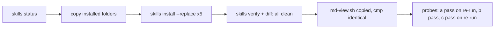

# Install refresh (slice 11)

- Date: 2026-11-05
- Status: done for 5 skills and `md-view.sh`. Config verified. Fresh-session loading verified on all 3 platforms: Codex passed in the first run; Claude Code and Cursor were blocked by permission prompts in the first run and passed in a re-run that needed no file read.
- Scope: refresh the installed copies of 5 skills and the installed `md-view.sh`. `thread-continuity` was not installed. Nothing committed or pushed.
- Run log: `<run folder>/install-refresh.log`

> `<run folder>` is the mission's local run folder on the owner's machine. It is not part of the repository.

## Skills refreshed

Each installed copy was backed up before the refresh. The installer also backed up each replaced copy under `.state/backups/skills/` in the main checkout.

| Skill | Before | Action | After | Installer backup (main checkout `.state/`) |
|---|---|---|---|---|
| autonomous-engineering | unmanaged: copy differs from source, no receipt | replaced | current, receipt created | `backups/skills/2026-11-06T05-01-45-630Z/autonomous-engineering/agents` |
| multi-agent-planning | stale: matched its old receipt, source newer | updated | current | `backups/skills/2026-11-06T05-01-45-946Z/multi-agent-planning/agents` |
| subagent-budget | modified: differs from its receipt; extra `SKILL.md.bak` | replaced | current | `backups/skills/2026-11-06T05-01-46-162Z/subagent-budget/agents` |
| grill-me | unmanaged | replaced | current, receipt created | `backups/skills/2026-11-06T05-01-46-378Z/grill-me/agents` |
| html-explainer | unmanaged | replaced | current, receipt created | `backups/skills/2026-11-06T05-01-46-610Z/html-explainer/agents` |

Pre-refresh copies: `<run folder>/installed-before/<name>`.

What the refresh changed in `SKILL.md`, old to new:

- `subagent-budget`: 2 lines added. Codex and Cursor children use `auto`, with the pstack exception for Cursor panels.
- `multi-agent-planning`: 11 changed lines. `autonomous-engineering`: 56. `html-explainer`: 6. `grill-me`: 2.
- No refusal. No foreign receipt. Each install reported `configurationVerified: true` and `behaviorVerified: false`.

`skills verify` for the 5 skills exits 0. Each `diff -rq -x '*.bak*'` against `tools/agents/skills/<name>` prints nothing.

## md-view.sh

- Source diff: 2 changed lines. The repo copy adds `ACCEPTED` to the state set and to the evidence rule for `VERIFIED` and `INTEGRATED`.
- Lines only in the installed copy: the 2 old versions of those lines. No other installed-only content. Nothing is lost.
- Both changed lines are inside the Python lint block of `md-view.sh`: the state set and the evidence rule now accept `ACCEPTED`. No other lint code changes.
- Backup: `~/.agents/bin/md-view.sh.bak-2026-11-05-slice11` (identical to the pre-change file).
- `cmp` of the installed copy against `tools/agents/bin/md-view.sh`: identical.
- `md-view.sh --check plans/system-design.md`: `fresh`. No rebuild needed.

## Fresh-session probes

| Probe | Platform | Result | Detail |
|---|---|---|---|
| a | Claude Code, `claude-haiku-5-5` | pass (re-run) | First run: the Read of `~/.agents/skills/subagent-budget/SKILL.md` hit a permission prompt. Re-run from an empty folder asked for the html-explainer description from the session's skill list; the answer was the new description. |
| b | Codex, read-only | pass | Exact expected line returned for `multi-agent-planning`. |
| c | Cursor | pass (re-run) | First run stopped at the workspace-trust prompt. Re-run with `--trust` in an empty temporary workspace quoted the new html-explainer description and the subagent-budget rule "There is no fixed cap on subagent count." |

The answers are in `<run folder>/fresh-session-probes.md`. The first run did not force the prompts. The re-run avoided the file read (Claude Code) and trusted only an empty temporary folder (Cursor).

## Undo

- `autonomous-engineering`, `grill-me`, `html-explainer`: run `skills uninstall <name>` with `--root <main checkout>`. Each receipt records its backup, so uninstall restores the pre-refresh copy.
- `multi-agent-planning`, `subagent-budget`: `skills uninstall` does not restore them. Their receipts have `backup: null`. To undo by hand:
  1. Rename the current folder: `mv ~/.agents/skills/<name> ~/.agents/skills/<name>.slice11-new`.
  2. Copy the old copy back: `cp -R <run folder>/installed-before/<name> ~/.agents/skills/<name>`.
  3. The receipt then no longer matches the files. `skills status` will show `modified` until the harness is re-run.
- `md-view.sh`: `mv ~/.agents/bin/md-view.sh ~/.agents/bin/md-view.sh.slice11-new`, then `cp ~/.agents/bin/md-view.sh.bak-2026-11-05-slice11 ~/.agents/bin/md-view.sh`.

## Open items

- Installer gap, outside this slice: `src/skills.ts` does not write the `backup` field when an install is `updated` or `replaced` over a receipt that has no backup. `uninstall` therefore cannot restore `multi-agent-planning` or `subagent-budget`. Fixing it would be a separate slice.
- `behaviorVerified` stays `false` for all 5. Fresh sessions show the new text (loading verified on Claude Code, Codex and Cursor), but no session was asked to use a skill on a real task, so behavior is not verified.
