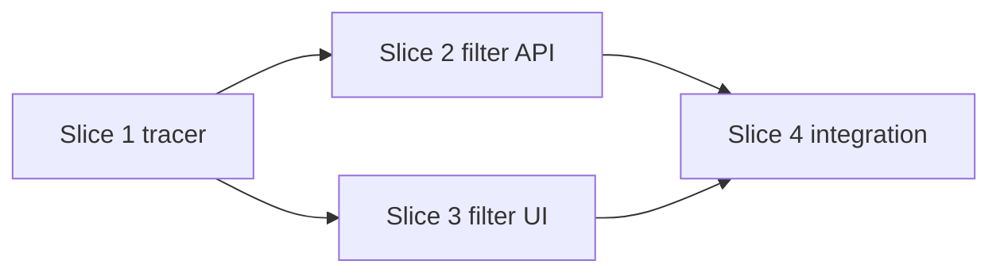

# Examples

Three illustrative planner outputs, for three of the four modes (no `deep` example; see "Waves" in `slice-format.md`). They are not real plans and were not run. Repos, files, and commands are invented.

- Each example is a complete plan page in a fenced block, so the page lint does not read it as a real slice.
- The fences use four backticks, so an example can hold a mermaid block.
- Fields, states, and waves follow `slice-format.md`. Every slice is `PLANNED`.

## 1. Quick: a small bug fix

````markdown
---
kind: plan
title: Fix due dates shown one day early
status: active
updated: 2026-10-25
planner: multi-agent-planning
mode: quick
---
Summary: Due dates show one day early for users west of UTC. One slice fixes the date formatter.
Goal: a due date shows the same calendar day that the user picked
Rules: plan only · reproduce first · no commit without the user

## Loop
1. Reproduce with a failing test, then fix · Codex (auto)
2. Review the diff · Claude (sonnet/medium)
3. Approve the merge · user

## Goal
- Outcome: a due date of 2026-11-03 shows "Nov 3" in every time zone.
- Tracer bullet: the slice itself. It goes from the stored value to the shown text.
- Out of scope: time-of-day display, the date picker.

## Existing state
- Fact: `src/format-date.js` passes the stored date string to `new Date()`, which reads it as UTC midnight.
- Fact: tests run with `npm test`.
- Assumption: dates are stored as `YYYY-MM-DD` with no time.
- Host capability: Codex `model` line in config, assumed. Not checked in this example.

## Design
- Parse `YYYY-MM-DD` as a local calendar date. Do not convert time zones.

## Model assignment
| Slice | Goal | Agent | Model | Effort | Reviewer | Fallback |
|---|---|---|---|---|---|---|
| 1 | Due date shows the picked day | Codex | auto | auto | Claude (sonnet/medium) | Claude (opus/high) |

- Slice 1: a repo-scoped bug fix with a clear repro is Codex volume work. Sonnet is enough to review a two-file diff.

## Slices
### Slice 1: local due date
- Goal: a due date shows the calendar day the user picked
- Model: Codex (auto)
- Review: Claude (sonnet/medium)
- Fallback: Claude (opus/high)
- Wave: 1 sequential
- Depends on: none
- Files: src/format-date.js, src/format-date.test.js
- Out of scope: src/date-picker.js
- Accept: with `TZ=America/New_York`, "2026-11-03" formats as "Nov 3"
- Verify: `TZ=America/New_York npm test -- src/format-date.test.js`, and the "2026-11-03" → "Nov 3" case passes
- State: PLANNED
- Evidence: none
- [ ] Write the failing test, then fix the parser · Codex (auto) · Verify command passes · revert the two files

## Waves
- Wave 1 sequential: slice 1. Quick mode has no parallel wave.
- Critical path: slice 1.

## Usage
- One worker. Remaining usage: unknown. No quota is assumed.

## Risks
| Risk | Mitigation |
|---|---|
| Other callers rely on the UTC behavior | The reviewer searches for other callers of `formatDate` in the diff review |

## First action
- Slice 1, owner Codex (auto), after the user asks for execution.

## Execution state
- planned 1 · running 0 · blocked 0 · reviewed 0 · verified 0 · integrated 0
- Nothing was launched.
````

## 2. Standard: a full-stack feature

````markdown
---
kind: plan
title: Tags on notes
status: active
updated: 2026-10-25
planner: multi-agent-planning
mode: standard
---
Summary: Users tag notes and filter the note list by tag. A tracer goes first, then the API and the UI in parallel, then integration.
Goal: a user tags a note and then sees only the notes with that tag
Rules: plan only · no commit or push without the user · AGENT_FINISHED is not VERIFIED

## Loop
1. Build the tracer: one tag saved and shown · Claude (opus/high)
2. Build the filter API and the filter UI in parallel · Codex (auto), Cursor (auto)
3. Integrate and run the end-to-end test · Claude (sonnet/medium)
4. Smoke-test and approve the merge · user

## Goal
- Outcome: a user tags a note and filters the list by that tag.
- Tracer bullet: a tag typed in the UI goes through the API into the database and shows on the note after reload.
- Out of scope: tag rename, tag colors, shared tags.

## Existing state
- Fact: migrations are in `db/migrations/`. The latest is `002_notes.sql`.
- Fact: Express routes are in `server/`. Routes mount in `server/routes.js`.
- Fact: the React UI is in `web/`. Tests run with `npm test`.
- Assumption: tags belong to one user.
- Whether CI runs `npm run e2e`: unknown
- Host capabilities: model lists not checked in this example. Codex and Cursor stay `auto`.

## Requirements
| ID | Requirement | Source |
|---|---|---|
| REQ-1 | When a user adds a tag to a note, the app saves it and shows it on that note after reload | user |
| REQ-2 | When a user picks a tag filter, the app shows only the notes with that tag | user |

## Decisions
| ID | Decision | By |
|---|---|---|
| DEC-1 | Store tags in `tags` and `note_tags`, not in a notes column | agent |

## Evals
| ID | REQ | Check | Method | Result |
|---|---|---|---|---|
| EVAL-1 | REQ-1 | Add tag "food" to a note, reload, see "food" on the note | browser | not run |
| EVAL-2 | REQ-2 | With 3 notes and 1 tagged "food", filter by "food" and see exactly that note | browser | not run |

## Design
- Tables: `tags(id, user_id, name)` and `note_tags(note_id, tag_id)`.
- Shared interface, fixed before wave 2:
  - `POST /tags` with `{"noteId":1,"name":"food"}` returns 201 and the tag.
  - `GET /notes?tag=food` returns a JSON array of notes.
- Reuse the existing route and component patterns.

## Model assignment
| Slice | Goal | Agent | Model | Effort | Reviewer | Fallback |
|---|---|---|---|---|---|---|
| 1 | One tag saved and shown | Claude | opus | high | Claude (opus/high, fresh session) | Codex (auto) |
| 2 | Filter notes by tag in the API | Codex | auto | auto | Claude (sonnet/medium) | Claude (opus/high) |
| 3 | Filter notes by tag in the UI | Cursor | auto | auto | Claude (sonnet/medium) | Codex (auto) |
| 4 | Integrate and test end to end | Claude | sonnet | medium | Claude (opus/high, fresh session) | Claude (sonnet/medium, fresh session) |

- Slice 1: the schema and the API contract cross three layers. That is Claude contract work. A cross-layer tracer gets a fresh Claude session as reviewer, not Codex.
- Slice 2: a clear spec in one folder. Codex volume work. Sonnet reviews; a separate opus session takes over if the escalation step fails.
- Slice 3: UI iteration. Cursor. Codex takes over if needed, so Claude reviews.
- Slice 4: the integrator built neither slice 2 nor slice 3. Wiring and one test need only sonnet. Only Claude built neither slice, so the fallback is a new Claude session at the same rung, and the reviewer is another fresh session. The one-rung escalation stays out of `Fallback:`. Codex is not the fallback because it built slice 2.

## Slices
### Slice 1: tracer, one tag saved and shown
- Goal: a tag typed on a note is saved and shows on that note after reload
- Model: Claude (opus/high)
- Review: Claude (opus/high, fresh session)
- Fallback: Codex (auto)
- Wave: 1 sequential
- Depends on: none
- Files: db/migrations/003_tags.sql, server/tags.js, server/tags.test.js, server/routes.js, web/TagInput.jsx
- Out of scope: web/NotesPage.jsx
- Accept: POST /tags returns 201, and the tag shows on the note after reload
- Verify: `npm test -- server/tags.test.js` passes. Then run `npm run dev`, open a note, add the tag "food", reload, and see "food" on the note
- State: PLANNED
- Evidence: none

### Slice 2: filter API
- Goal: GET /notes?tag=food returns only the notes tagged "food"
- Model: Codex (auto)
- Review: Claude (sonnet/medium)
- Fallback: Claude (opus/high)
- Wave: 2 parallel
- Depends on: slice 1
- Files: server/notes-filter.js, server/notes-filter.test.js, server/routes.js
- Out of scope: web/, db/
- Accept: with 3 notes and 1 tagged "food", the response has exactly that note
- Verify: `npm test -- server/notes-filter.test.js`, and the 3-notes case passes
- State: PLANNED
- Evidence: none

### Slice 3: filter UI
- Goal: a click on a tag chip shows only the notes with that tag
- Model: Cursor (auto)
- Review: Claude (sonnet/medium)
- Fallback: Codex (auto)
- Wave: 2 parallel
- Depends on: slice 1
- Files: web/TagFilter.jsx, web/TagFilter.test.jsx
- Out of scope: server/, db/, web/NotesPage.jsx
- Accept: with fetch mocked to the fixed `GET /notes?tag=` contract (mock), a click on "food" renders only the food notes
- Verify: `npm test -- web/TagFilter.test.jsx`, and the "food" click case passes
- State: PLANNED
- Evidence: none

### Slice 4: integration
- Goal: on the notes page, a user filters by tag against the real API
- Model: Claude (sonnet/medium)
- Review: Claude (opus/high, fresh session)
- Fallback: Claude (sonnet/medium, fresh session)
- Wave: 3 integration
- Depends on: slice 2, slice 3
- Files: web/NotesPage.jsx, e2e/tags.spec.js
- Accept: the end-to-end test tags a note, filters by the tag, and sees one note
- Verify: `npm run e2e -- e2e/tags.spec.js`, and its case "tag a note, filter, see one note" passes against the real API
- State: PLANNED
- Evidence: none
- [ ] Smoke test: run `npm run dev`, open /notes, tag one note "food", click "food" · user · you see only that note · revert the merge

## Waves


| Wave | Slices | Starts when |
|---|---|---|
| 1 sequential | 1 | the user asks for execution |
| 2 parallel | 2, 3 | slice 1 is VERIFIED and in a commit that the user approved |
| 3 integration | 4 | slices 2 and 3 are VERIFIED and in a commit that the user approved |

- Critical path: slice 1 → slice 2 → slice 4.
- Wave 2 files: slice 2 owns 3 files in `server/`, slice 3 owns 2 files in `web/`. No overlap.
- Commit gate: slice 2 edits `server/routes.js`, which slice 1 owns. Wave 2 worktrees start only from a commit that contains VERIFIED slice 1. Without that commit, run slices 2 and 3 one at a time in the shared checkout after the coordinator applies the VERIFIED slice 1 diff to it (`git apply`, no commit), or ask the user.

## Usage
- Wave 2 runs 2 workers, Codex and Cursor, each in its own worktree. Claude stays free to review slices 2 and 3.
- Remaining usage per subscription: unknown. The plan assumes no quota.
- Grok: not used. It may critique the Design before wave 2. Its findings go in Existing state. The plan does not depend on it.

## Risks
| Risk | Mitigation |
|---|---|
| The UI and the API disagree on the filter contract | The contract is fixed in Design before wave 2. Slice 4 runs the real API |
| Slice 3 tests use a mocked fetch | The mock is named in slice 3 Accept. The slice 4 end-to-end test covers the real call |

## First action
- Slice 1, owner Claude (opus/high), after the user asks for execution.

## Execution state
- planned 4 · running 0 · blocked 0 · reviewed 0 · verified 0 · integrated 0
- Nothing was launched. No worktree exists.
````

## 3. Sprint: a three-hour hackathon

````markdown
---
kind: plan
title: Receipt splitter demo
status: active
updated: 2026-10-25
planner: multi-agent-planning
mode: sprint
---
Summary: In three hours, a live demo where a group enters a receipt and sees what each person owes.
Goal: at 3:00, demo a receipt split into per-person totals
Rules: demo before polish · mock only the receipt reader, and say so in the demo · plan only

## Loop
1. Build the tracer: typed items split into totals · Claude (opus/medium)
2. Build the receipt reader and the share screen in parallel · Codex (auto), Cursor (auto)
3. Integrate and write the demo script · Claude (sonnet/medium)
4. Rehearse the demo · user

## Goal
- Outcome: a group enters a receipt and sees each person's total.
- Tracer bullet: typed items and names go to the server, which returns per-person totals to the page.
- Out of scope: accounts, payments, real OCR.

## Existing state
- Fact: an empty Node repo with `npm test` set up.
- Assumption: a laptop browser is the only demo device.
- Paid OCR API access: unknown. It needs the user's authorization, so the reader uses a fixture.

## Requirements
| ID | Requirement | Source |
|---|---|---|
| REQ-1 | When the group enters items, prices, and names, the app shows each person's total | user |
| REQ-2 | When the user uploads the sample receipt, the app fills the item list | user |
| REQ-3 | When the totals are ready, the share screen shows one card per person | user |

## Decisions
| ID | Decision | By |
|---|---|---|
| DEC-1 | The receipt reader is a fixture-backed mock. No paid OCR API | agent |

## Evals
| ID | REQ | Check | Method | Result |
|---|---|---|---|---|
| EVAL-1 | REQ-1 | A $20 pizza shared by Ana and Bo shows $10 each on the page | browser | not run |
| EVAL-2 | REQ-2 | The sample receipt gives 4 items with the right prices | unit | not run |
| EVAL-3 | REQ-3 | Totals of $10 and $10 show as 2 cards | browser | not run |
| EVAL-4 | REQ-1, REQ-2, REQ-3 | A person who did not build it follows DEMO.md to the share screen in under 3 minutes | human | not run |

## Design
- `POST /split` with `{"items":[{"name":"pizza","price":20,"people":["Ana","Bo"]}]}` returns `{"Ana":10,"Bo":10}`.
- The receipt reader returns the same `items` shape. The share screen reads the same totals shape.

## Model assignment
| Slice | Goal | Agent | Model | Effort | Reviewer | Fallback |
|---|---|---|---|---|---|---|
| 1 | Typed items split into totals | Claude | opus | medium | Claude (opus/high, fresh session) | Codex (auto) |
| 2 | Sample receipt fills the items | Codex | auto | auto | Claude (sonnet/medium) | Claude (opus/high) |
| 3 | Share screen shows the totals | Cursor | auto | auto | Claude (sonnet/medium) | Codex (auto) |
| 4 | Integrated demo and script | Claude | sonnet | medium | user | Claude (sonnet/medium, fresh session) |

- Slice 1: sets the shared shape for all later slices. Medium effort is enough for a small app. A cross-layer tracer gets a fresh Claude session as reviewer.
- Slice 2: a parser against a fixed shape. Codex.
- Slice 3: fast UI iteration. Cursor. Codex takes over if needed, so Claude reviews.
- Slice 4: wiring and a script. The user judges the demo.

## Slices
### Slice 1: tracer, typed items to totals
- Goal: typed items and names show per-person totals on the page
- Model: Claude (opus/medium)
- Review: Claude (opus/high, fresh session)
- Fallback: Codex (auto)
- Wave: 1 sequential
- Depends on: none
- Files: app/server.js, app/split.js, app/split.test.js, app/public/index.html
- Accept: on the page, a $20 pizza shared by Ana and Bo shows $10 each
- Verify: `npm test -- app/split.test.js` passes. Then run `npm start`, open http://localhost:3000, enter a $20 pizza for Ana and Bo, and see $10 each
- State: PLANNED
- Evidence: none

### Slice 2: receipt reader (fixture)
- Goal: an upload of the sample receipt fills the item list
- Model: Codex (auto)
- Review: Claude (sonnet/medium)
- Fallback: Claude (opus/high)
- Wave: 2 parallel
- Depends on: slice 1
- Files: app/receipt.js, app/receipt.test.js, app/fixtures/
- Out of scope: app/public/
- Accept: the sample receipt gives 4 items with the right prices. The reader is a fixture-backed mock (mock)
- Verify: `npm test -- app/receipt.test.js`, and the 4-item case passes; the reviewer confirms in the diff that `app/receipt.js` reads `app/fixtures/` and labels it a mock
- State: PLANNED
- Evidence: none

### Slice 3: share screen
- Goal: the totals show as one large card per person
- Model: Cursor (auto)
- Review: Claude (sonnet/medium)
- Fallback: Codex (auto)
- Wave: 2 parallel
- Depends on: slice 1
- Files: app/public/share.js, app/public/share.css, app/public/share.test.js
- Out of scope: app/server.js, app/public/index.html
- Accept: with the totals `{"Ana":10,"Bo":10}`, the page shows 2 cards, each with $10
- Verify: `npm test -- app/public/share.test.js` renders `{"Ana":10,"Bo":10}` as 2 cards and `{"Ana":5}` as 1 card; then run `npm start`, open http://localhost:3000/share.html?demo=1, and see 2 cards with $10
- State: PLANNED
- Evidence: none

### Slice 4: integrated demo
- Goal: upload, split, and share run as one flow in under 3 minutes
- Model: Claude (sonnet/medium)
- Review: user
- Fallback: Claude (sonnet/medium, fresh session)
- Wave: 3 integration
- Depends on: slice 2, slice 3
- Files: app/public/index.html, DEMO.md
- Accept: a person who did not build it follows DEMO.md and reaches the share screen
- Verify: the user, who did not build it, follows DEMO.md end to end on the demo laptop and reaches the share screen in under 3 minutes
- State: PLANNED
- Evidence: none
- [ ] Rehearse the demo from DEMO.md · user · you reach the share screen in under 3 minutes · present the slice 1 flow only

## Waves
| Wave | Slices | Checkpoint |
|---|---|---|
| 1 sequential | 1 | 0:45. If the tracer is not VERIFIED, ask the user to cut slice 2. On the user's yes, delete slice 2 from the plan, remove it from slice 4 `Depends on:`, rewrite slice 4 `Goal:`, `Accept:`, `Verify:`, the critical path, and the evals to the typed-item flow, and record the cut in Risks |
| 2 parallel | 2, 3 | 2:00. Both VERIFIED, or ask the user to cut the late slice. On the user's yes, delete it, remove it from slice 4 `Depends on:`, rewrite slice 4 `Goal:`, `Accept:`, `Verify:`, the critical path, and the evals to the slices that remain, and record the cut in Risks |
| 3 integration | 4 | 2:30. Rehearsal passes. Polish only after this |

- Critical path: slice 1 → slice 2 → slice 4.
- Wave 2 files: slice 2 owns `app/receipt.js`, `app/receipt.test.js`, and `app/fixtures/`. Slice 3 owns `app/public/share.js`, `app/public/share.css`, and `app/public/share.test.js`. No overlap.
- Commit gate: each wave starts from a commit that contains its VERIFIED dependencies. Slice 4 edits `app/public/index.html`, which slice 1 owns. Without a commit that the user approved, run the next wave one slice at a time in the shared checkout after the coordinator applies the VERIFIED dependency diffs to it (`git apply`, no commit), or ask the user.
- A cut slice is deleted from the plan. It is never marked VERIFIED.

## Usage
- 2 workers in wave 2, each in its own worktree. A third worker has no independent work, so none starts.
- Remaining usage: unknown. No quota is assumed.

## Risks
| Risk | Mitigation |
|---|---|
| The receipt reader is a mock | Slice 2 Accept names it. The demo says "sample receipt" |
| Wave 2 runs late | At 2:00, the user may cut the late slice. The demo still runs on slice 1 |

## First action
- Slice 1, owner Claude (opus/medium), after the user asks for execution.

## Execution state
- planned 4 · running 0 · blocked 0 · reviewed 0 · verified 0 · integrated 0
- Nothing was launched. No worktree exists.
````
